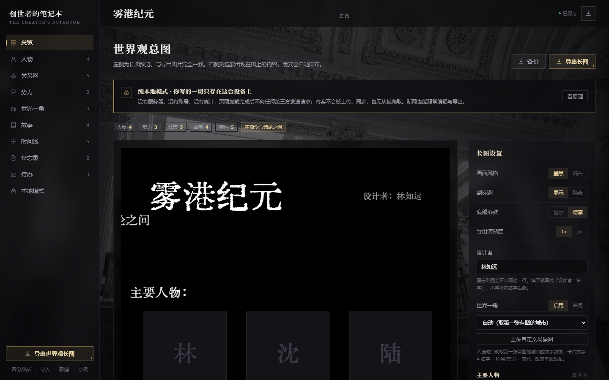
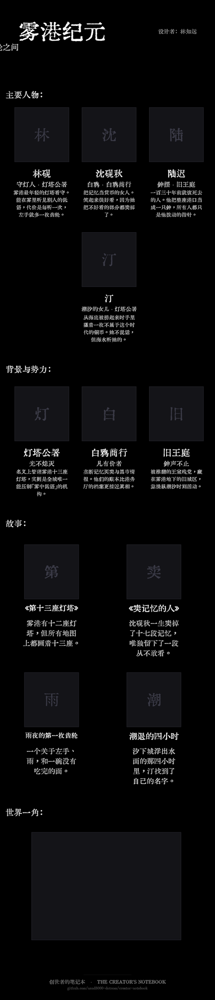
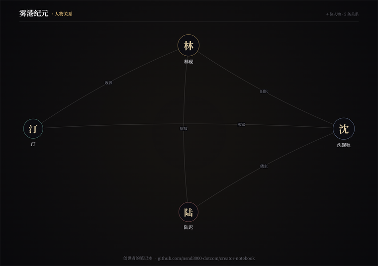

# 创世者的笔记本 · The Creator's Notebook

一个纯静态的世界观管理站：把散落在笔记里的世界设定，整理成一页可翻阅的档案，再导出一张能直接分享的长图。

不装环境、不连后端、不注册账号——双击 `index.html` 就能用。

**[→ 在线使用](https://nsnd3000-dotcom.github.io/creator-notebook/)** ｜ [源码](https://github.com/nsnd3000-dotcom/creator-notebook) ｜ [为什么它不会上传你的内容](https://nsnd3000-dotcom.github.io/creator-notebook/#privacy)



> **纯本地模式**：没有服务器、没有账号、没有统计，页面加载完成后不向任何第三方发送请求。你写的一切只存在这台设备的浏览器里，不上传、不同步，也没有可被爬虫抓取的介质。断网也能照常编辑与导出——这一条可以当场验证：打开页面后拔掉网线，功能一切照常。

## 它能做什么

- **八个板块**：概览 / 人物 / 关系网 / 势力 / 城市与背景 / 故事 / 备忘录 / 待办，外加一条时间线
- **备忘录与待办**：只给自己看的两页，支持搜索便签、勾选待办、清除已完成；它们不进长图
- **人物关系图**：节点自由拖动，松手即记住位置；可单独导出成图片
- **长图导出**：1080 宽基准，1× / 2× 两档清晰度，墨黑 / 纸白两种风格；副标题、底部落款、世界一角（场景大图）都能逐项开关
- **数据自持**：内容存在浏览器本地，可一键备份为 JSON、也能导入回来；换设备时带着那个文件走
- **图片裁剪**：上传的人物/场景图可以在页面里直接裁成方形
- **窄屏可用**：手机与平板（≤860px）把左侧栏收成顶栏的目录按钮，点开是整页目录抽屉，十项一屏可及，不再需要横向拖动

导出效果（示例世界「雾港纪元」）：



## 纯本地模式

这个站点没有后端。HTML、CSS、JS、背景图和字体就是它的全部，数据只落在浏览器的 IndexedDB 与 localStorage 里，导出靠 Canvas 在内存里画。

- **不带任何网络依赖**：无 CDN、无在线字体服务、无统计埋点；字体 `huiwen-mincho.woff2` 就在仓库里
- **同源策略保护**：别的网站、别的标签页读不到你的数据；网页也没有权限直接读写你的硬盘
- **爬虫无从下手**：公开可爬的只有一个空白编辑器，内容需要本机的浏览器上下文才能读
- **唯一的例外都写在明处**：托管平台的访问日志（任何网站都有）、你主动粘贴图片链接时向该地址取图一次

完整说明与验证方法：点界面左下导航的「本地模式」，或直接访问 `#privacy`。

## 快速开始

```bash
git clone https://github.com/nsnd3000-dotcom/creator-notebook.git
cd creator-notebook
```

然后双击 `index.html`，或者拖进浏览器。

建议 **Chrome / Edge**（用到了 Canvas、IndexedDB、backdrop-filter）。`file://` 直接打开即可，不需要起本地服务器。

第一次打开是空的，点左下角「示例」可以载入一份完整的示例世界，看看各字段大概怎么填。

## 目录结构

```
creator-notebook/
├── index.html            入口（单页，hash 路由）
├── assets/
│   ├── style.css         全部样式
│   ├── app.js            路由、视图、事件（事件委托，data-act）
│   ├── store.js          数据模型与持久化（IndexedDB + localStorage 兜底）
│   ├── poster.js         Canvas 长图渲染与导出
│   ├── relations.js      SVG 关系图（增量渲染 + 拖拽 + 图片导出）
│   ├── imagekit.js       图片压缩与裁剪
│   ├── bg.jpg            背景图
│   └── fonts/
│       └── huiwen-mincho.woff2
└── docs/                 README 用的截图
```

零运行时依赖：没有 npm、没有构建步骤、没有框架。

## 字体

- **汇文明朝体**（`assets/fonts/huiwen-mincho.woff2`）：用于导出长图与品牌字。原版 OTF 约 24MB，这里是转码压缩后的 woff2（7.7MB）。该字体为 **Public Domain**。
- **思源宋体 / Noto Serif SC**：界面标题，走系统既有字体，不随仓库分发。

## 数据存在哪

| 内容 | 位置 |
| --- | --- |
| 世界设定（人物、势力、故事等） | IndexedDB |
| 关系图节点位置、长图设置 | localStorage |

全部留在你自己的浏览器里，不上传任何服务器。代价是：清缓存 / 换浏览器 / 换设备会丢，**记得用「备份数据」导出 JSON**。

## 关系网



节点按住就能拖，位置会被记住；右上角「重新布局」可以一键回到环形排布，「导出关系图」按当前摆放取景出图。

## 状态

**在线版**：<https://nsnd3000-dotcom.github.io/creator-notebook/>（GitHub Pages，纯静态托管，不含任何服务端逻辑）

**测试版（v0.1.0-test）**——功能完整可用，但数据结构仍可能调整，导入旧备份前建议先另存一份。

## 许可

代码暂未指定开源许可证；字体部分见上文（汇文明朝体为 Public Domain）。

---

底部署名：`创世者的笔记本 · The Creator's Notebook · github.com/nsnd3000-dotcom/creator-notebook`
